# 🕵️ Maltego: Installation, Activation and First OSINT Investigation

> Module: Reconnaissance / OSINT
> Tool: **Maltego Graph (Desktop) 4.14.0**
> Platform: Windows (.exe + Java x64)

## 📌 Overview

**Maltego** is an OSINT (Open Source Intelligence) investigation tool that represents information as **graphs**. It links entities (domains, emails, people, IPs, etc.) using **Transforms**, which are automated queries to data sources.

This guide covers:
1. Downloading and installing Maltego
2. Activating it with a Maltego ID
3. Configuring data sources
4. A first investigation: finding email addresses linked to a domain

---

## 1. Download

1. Go to the official page: https://www.maltego.com/downloads/
2. Select the **Windows** operating system and the **.exe + Java (x64)** extension
3. Click **Download Maltego Graph** (version 4.14.0)

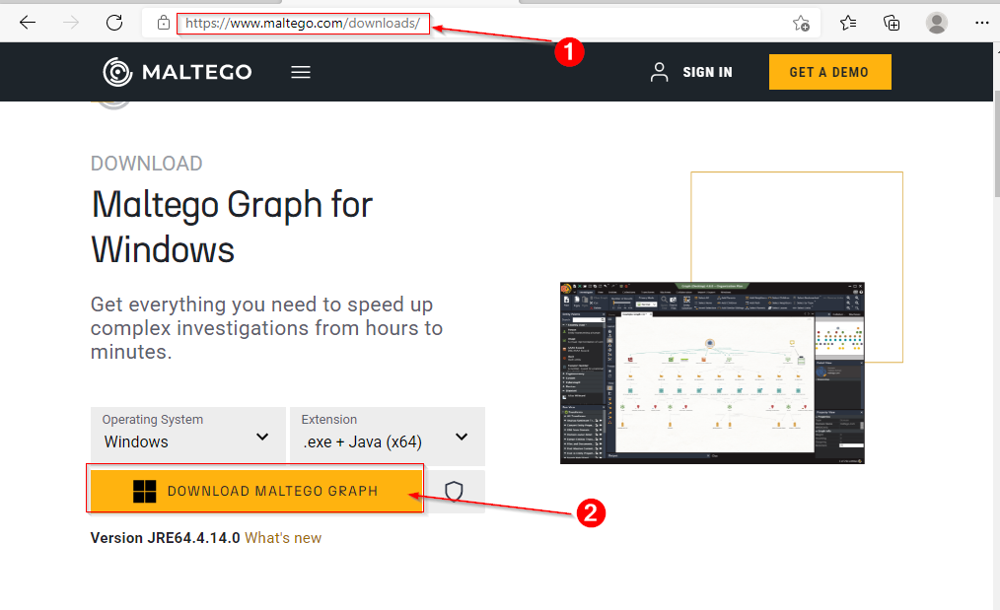

## 2. Installation

1. Run the downloaded installer
2. Close all other applications, then click **Next >**
3. Follow the wizard until the installation is complete

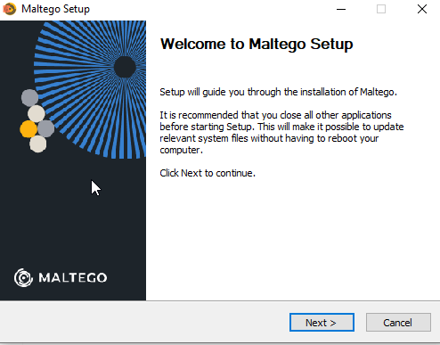

## 3. Product Activation

### 3.1 Choosing the activation method

On first launch, select **MALTEGO ID** (for new users), then click **Next**.

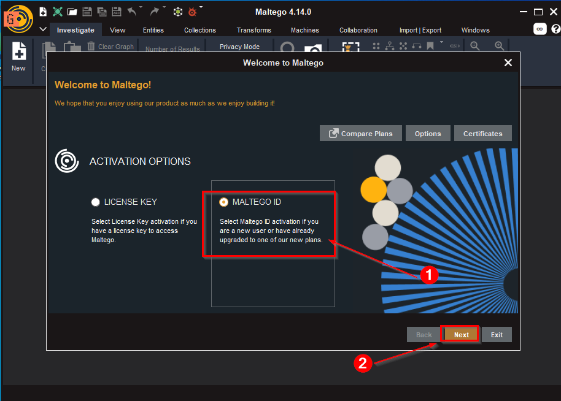

Choose **Online Activation (Default)**, then click **Next**.

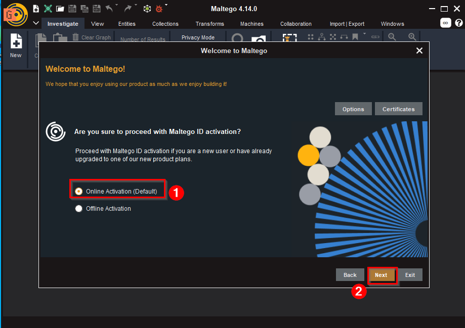

### 3.2 License agreement

Read the agreement, tick **Accept**, then click **Next**.

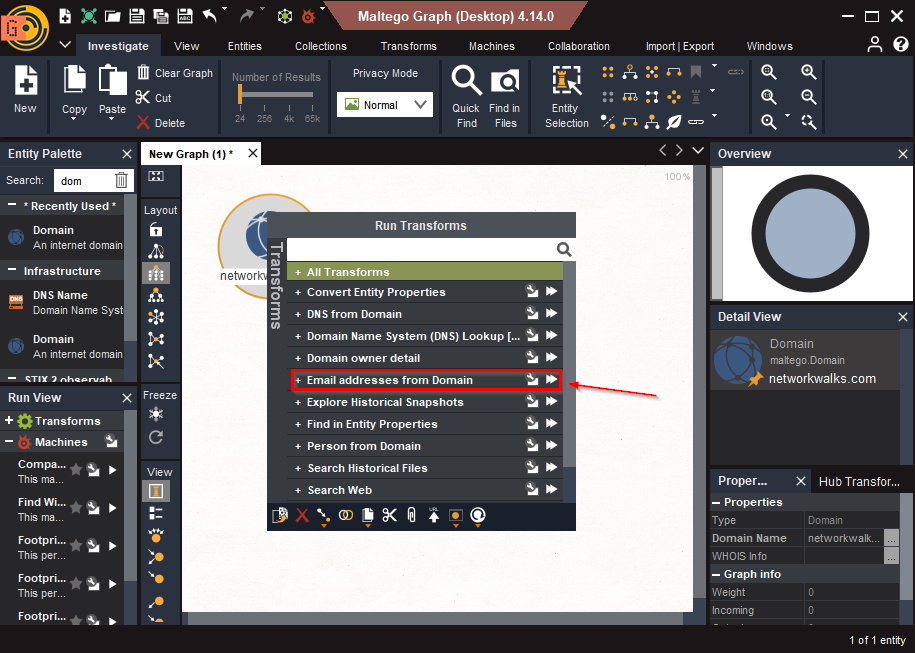

### 3.3 Browser login

Click **Browser Login**. The login page opens in your default browser.

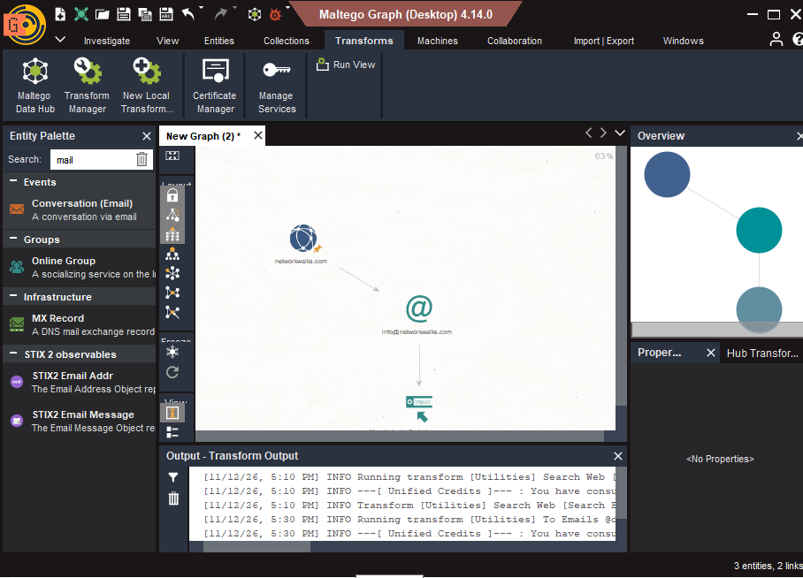

The Maltego client then waits for the authentication signal from the browser.

### 3.4 Creating a Maltego ID (if you have no account)

1. On the login page, click **CREATE ID**

2. Enter a valid email address, your first name and last name, then click **CONTINUE**

3. Once validated, the **Authentication complete** message appears. Close the browser and return to the application.

### 3.5 Successful activation

The **Activation Successful!** message confirms that Maltego is activated. Click **Next**.

## 4. Data Sources Configuration

1. **Select Data Sources**: keep **Utilities** checked, then click **Next**

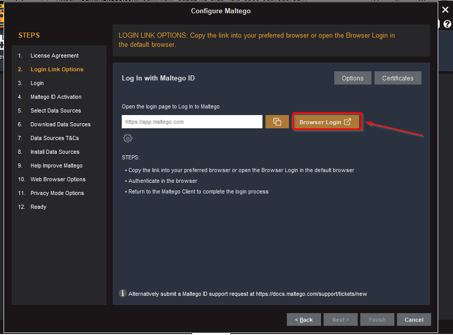

2. **Download Data Sources**: Maltego downloads the transforms (e.g. 238 Transforms, 245 Entities, 79 Transform Sets, 14 Machines)

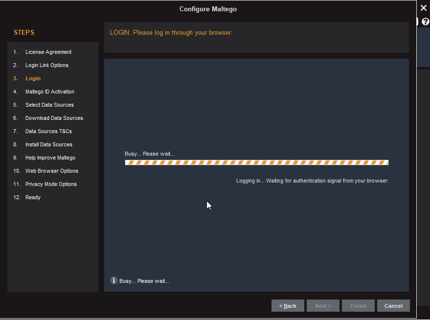

3. Continue through the wizard (T&Cs, web browser options, privacy mode) until **Finish**.

## 5. Maltego Interface

Once the configuration is done, the workspace opens with:
- **Entity Palette**: the list of available entity types
- **Graph**: the central area where the investigation is built
- **Run View / Transforms**: used to launch transforms and machines
- **Detail View / Properties**: details of the selected entity
- **Overview**: a global view of the graph

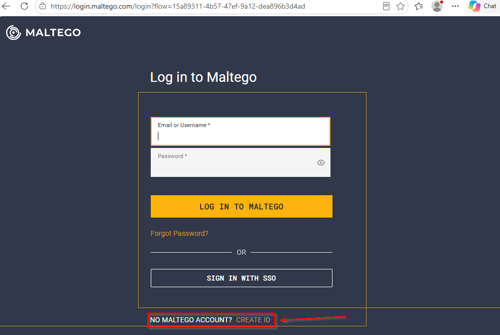

## 6. First Investigation: Emails of a Domain

### Step 1: Add a Domain entity
1. In the **Entity Palette**, search for `dom` and drag the **Domain** entity onto the graph
2. Double-click it and set the **Domain Name** (e.g. `networkwalks.com`)
3. Confirm with **OK**

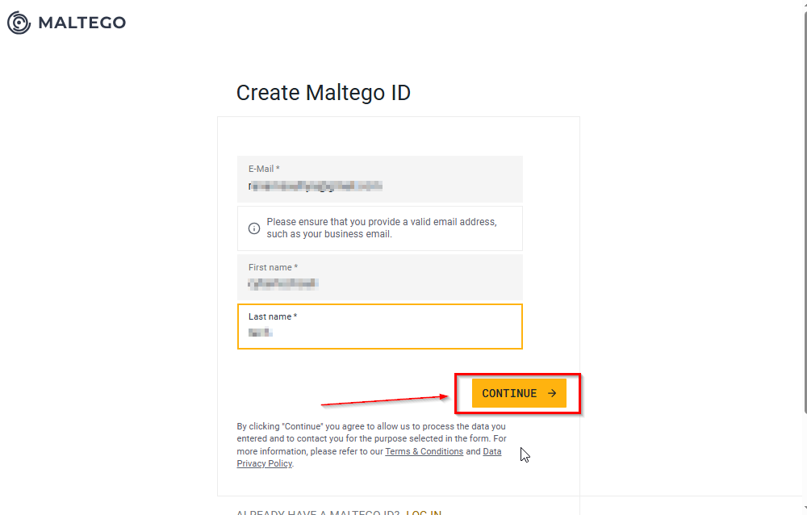

### Step 2: Run a transform
1. Right-click the entity, then open **Run Transforms**
2. Select **Email addresses from Domain**

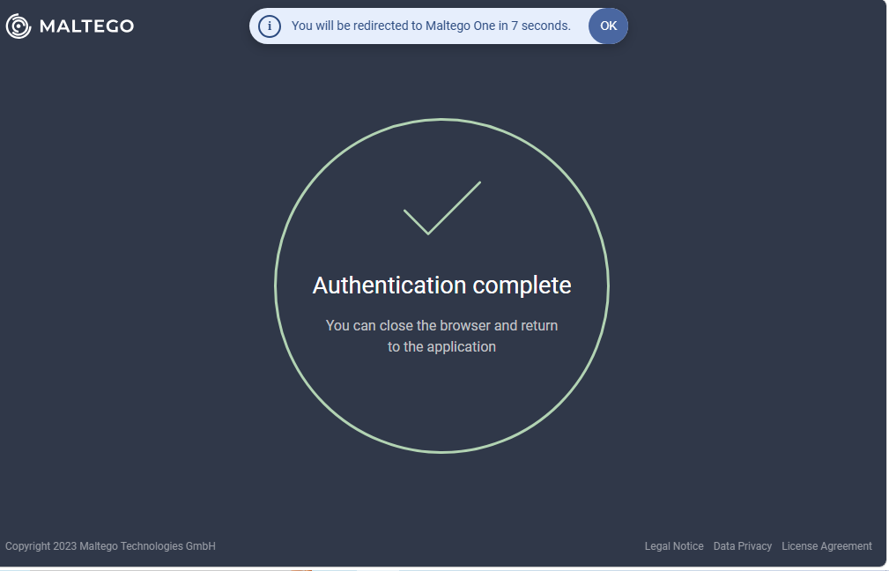

### Step 3: Analyze the result
The graph shows the domain linked to the email address found (e.g. `info@networkwalks.com`). The **Output - Transform Output** window shows the transform execution and credit consumption.

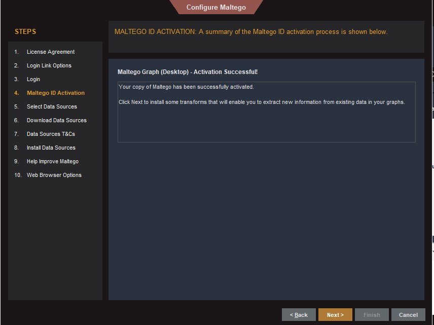

## 📝 Key Takeaways

| Concept | Description |
|---|---|
| **Entity** | A piece of information (domain, email, person, etc.) |
| **Transform** | An automated query that produces new entities from an existing one |
| **Machine** | An automated sequence of transforms |
| **Maltego ID** | Account required to activate and use the software |
| **Credits** | Each transform consumes credits depending on your plan |

## ⚠️ Legal and Ethical Disclaimer

Use Maltego only on targets you are **authorized** to investigate (audit, pentest, training) or on public data, and always in compliance with the law (GDPR, local data protection laws). The author accepts no responsibility for misuse.

## 📚 Resources

- Official website: https://www.maltego.com
- Download page: https://www.maltego.com/downloads/
