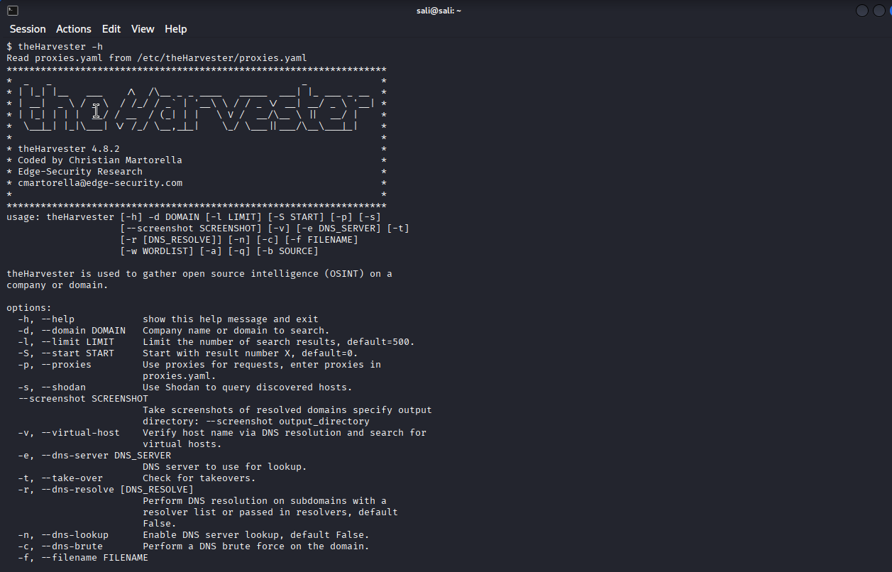
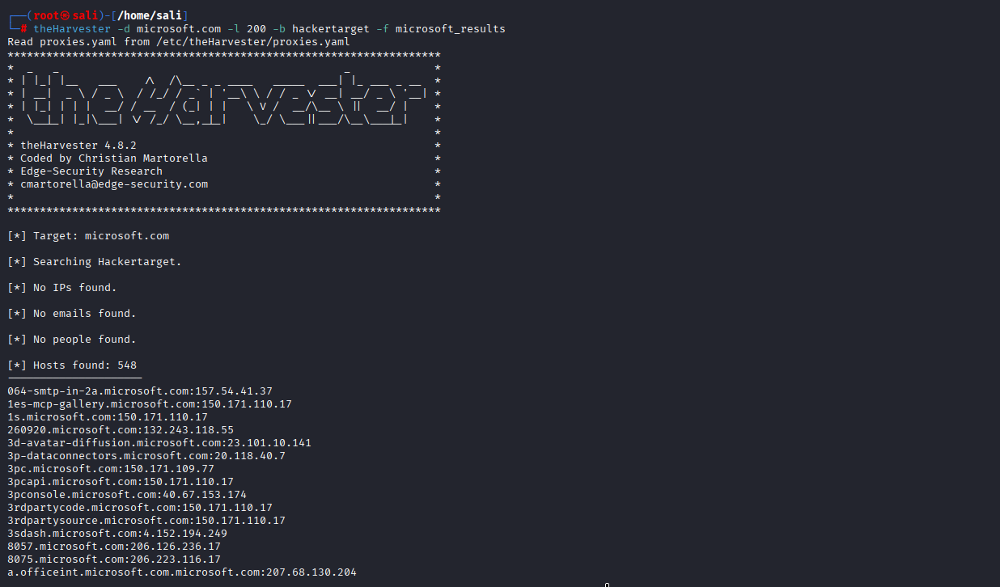
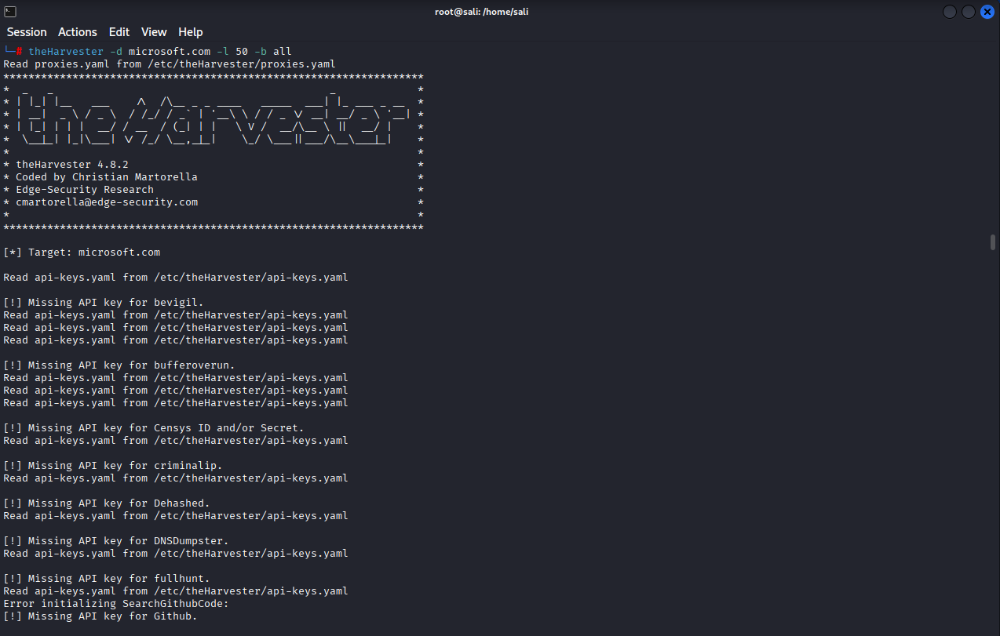

## 8. theHarvester: Passive Subdomain and Host Discovery

**theHarvester** is a command-line OSINT tool (included in Kali Linux) that gathers subdomains, IP addresses, emails and hosts for a domain from public sources.

> ⚠️ **Passive sources only.** The commands below query third-party databases (crt.sh, HackerTarget, RapidDNS...) and send no request to the target's servers. Do not use active options (`-c` DNS brute force, `-t` takeover, `--screenshot`) on a target without written authorization.

### Basic usage

```bash
theHarvester -d microsoft.com -l 200 -b hackertarget
```

| Option | Meaning |
|---|---|
| `-d` | Target domain |
| `-l` | Limit the number of results |
| `-b` | Data source (e.g. `crtsh`, `rapiddns`, `hackertarget`, `all`) |
| `-f` | Save results to XML and JSON files |

Result: **548 hosts** found, in the format `subdomain:IP`.



### Saving the results

```bash
theHarvester -d microsoft.com -l 200 -b hackertarget -f microsoft_results
```

This creates `microsoft_results.json` and `microsoft_results.xml`.



### Using all sources

```bash
theHarvester -d microsoft.com -l 50 -b all
```

This query returned **1315 hosts**, **30 IPs** and **5 ASNs**. No emails or people were found.



### Troubleshooting

| Message | Cause | Fix |
|---|---|---|
| `Missing API key for ...` | The source requires an API key (Shodan, Hunter, Censys...) | Add the key to `/etc/theHarvester/api-keys.yaml`, or ignore it. Use `-q` to hide the warnings |
| `Cannot connect to host wappass.baidu.com` | Baidu blocks automated requests | Use `crtsh`, `rapiddns` or `hackertarget` instead |
| `Server disconnected` | Bing or Baidu detect a script and cut the connection | Use another source |
| `No IPs found` with hosts listed | IPs are shown inside the hosts list (`subdomain:IP`) | Not an error |

### Cleaning the results

```bash
grep -oE '[A-Za-z0-9._-]+\.microsoft\.com' microsoft_results.json | tr 'A-Z' 'a-z' | sort -u > hosts.txt
wc -l hosts.txt
```

This removes duplicates and case differences.
