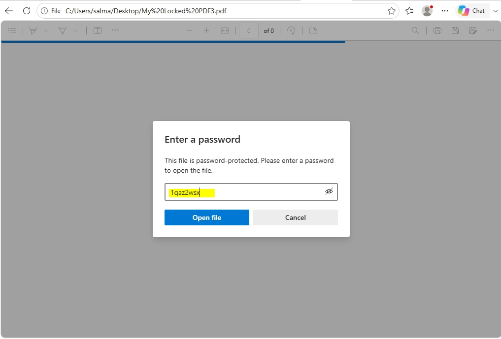
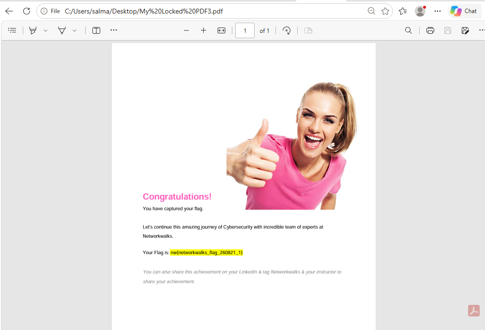
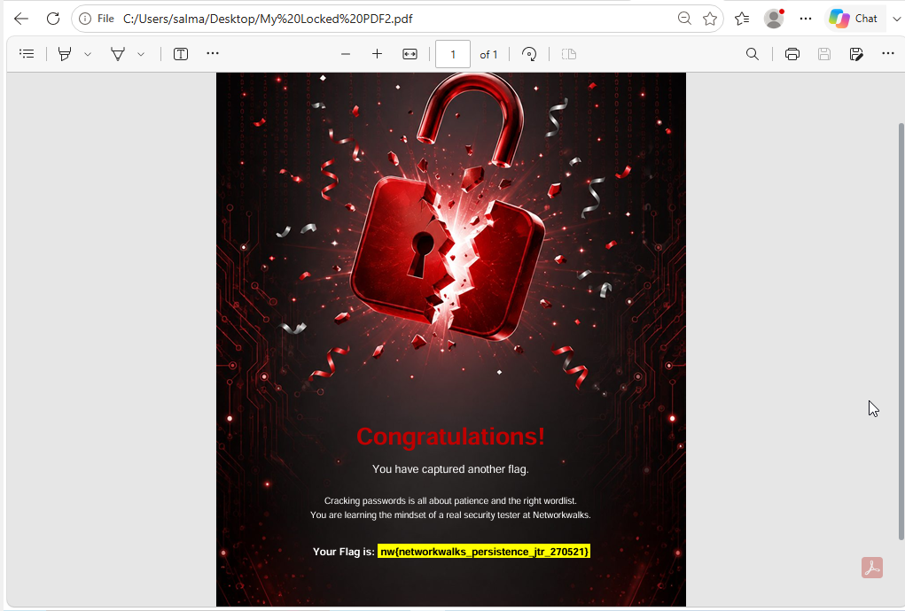
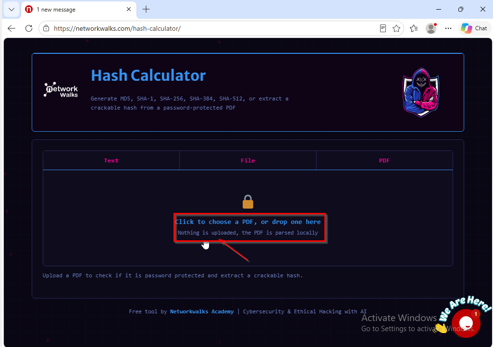
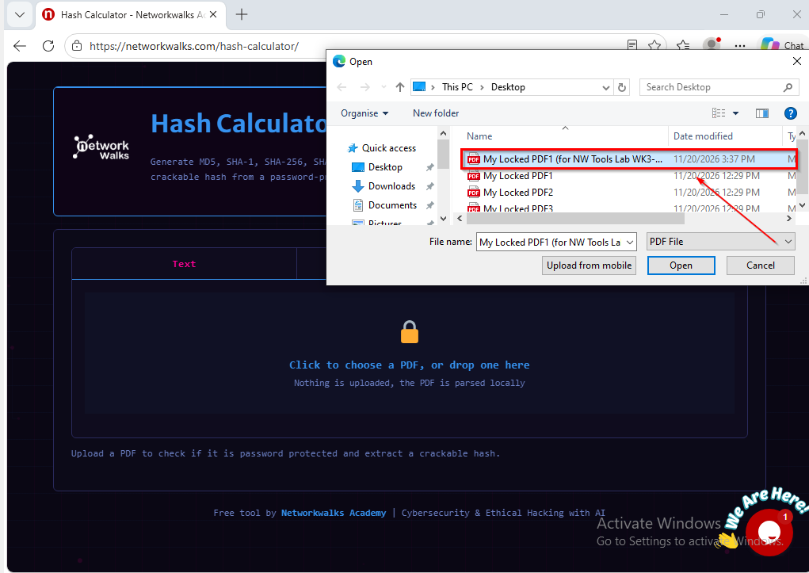
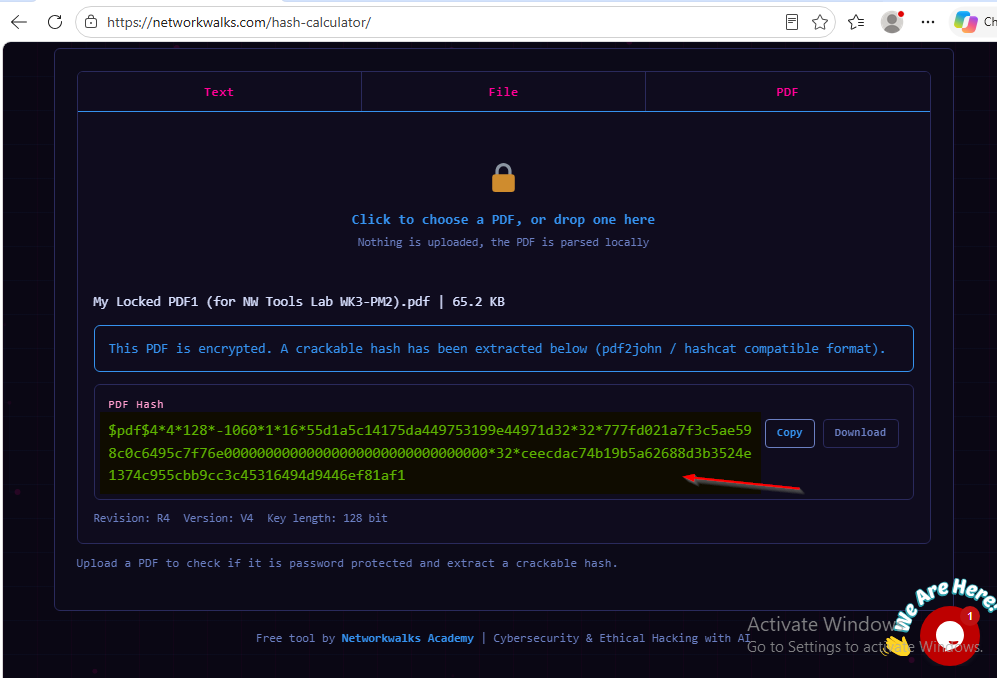

# 🔐 Cracking Password-Protected PDFs with Networkwalks Online Tools

This module is part of my **Cybersecurity Internship** at **NetworkWalks**.
It documents, step by step, how to recover the password of a protected PDF file using **Networkwalks Academy's own online tools**:

- **Hash Calculator** — extracts a crackable hash from an encrypted PDF (pdf2john / hashcat compatible format)
- **Password Cracker (Dictionary Attack Lab)** — runs a dictionary attack against the extracted hash, the same way John the Ripper does

Unlike Module 1 (which used the local Johnny / John the Ripper setup), this module shows the same password-recovery workflow performed entirely in the browser, without installing anything.

> ⚠️ **Legal / Ethical Notice**
> This walkthrough is for educational purposes only and for testing files you own or are explicitly authorized to test (CTF, training lab, authorized audit). Never use these techniques on files or systems without permission.

---

## 📋 Prerequisites

- A web browser with internet access
- A password-protected PDF file to test (e.g. `My Locked PDF1 (for NW Tools Lab WK3-PM2).pdf`)

---

## Step 1 — Open the Hash Calculator tool

Go to [https://networkwalks.com/hash-calculator/](https://networkwalks.com/hash-calculator/).

The tool offers three modes: **Text**, **File**, and **PDF**. Select the **PDF** tab, then click the upload area (or drag and drop a PDF). The page explicitly states that nothing is uploaded — the PDF is parsed **locally** in the browser.



---

## Step 2 — Upload the protected PDF

Click to browse the file system and select the locked PDF file (here: `My Locked PDF1 (for NW Tools Lab WK3-PM2).pdf`).



---

## Step 3 — Get the extracted hash

Once the PDF is parsed, the tool confirms that the file is encrypted and extracts a crackable hash in a **pdf2john / hashcat compatible format**, along with metadata (Revision, Version, Key length).

Click **Copy** to copy the hash to the clipboard (or **Download** to save it as a file).



---

## Step 4 — Run the Password Cracker (Dictionary Attack Lab)

Go to [https://networkwalks.com/password-cracker/](https://networkwalks.com/password-cracker/).

Paste the `$pdf$...` hash obtained in Step 3, then run the attack. The tool tries every word from a wordlist against the hash — the same principle used by John the Ripper — and shows the live attempts (`Trying: service`, `Trying: canada`, etc.) along with progress (tried / total, passwords/second, % complete).

Once a match is found, the password is displayed: **`password1`** ✅



---

## Step 5 — Unlock the PDF with the recovered password

Open the locked PDF and enter the recovered password (`password1`).



The PDF opens successfully, revealing the captured flag:

```
nw{networkwalks_flag1_jtr_270521_1}
```



---

## 🧠 Workflow Summary

```
Locked PDF
     │
     ▼
Hash Calculator (networkwalks.com/hash-calculator)
     │
     ▼
Extracted $pdf$... hash (pdf2john / hashcat format)
     │
     ▼
Password Cracker - Dictionary Attack Lab (networkwalks.com/password-cracker)
     │
     ▼
Plaintext password
     │
     ▼
Unlocked PDF + captured flag
```

---

## 📚 Resources

- Networkwalks Hash Calculator: https://networkwalks.com/hash-calculator/
- Networkwalks Password Cracker: https://networkwalks.com/password-cracker/

---

*Module completed as part of my Cybersecurity Internship at NetworkWalks.*
